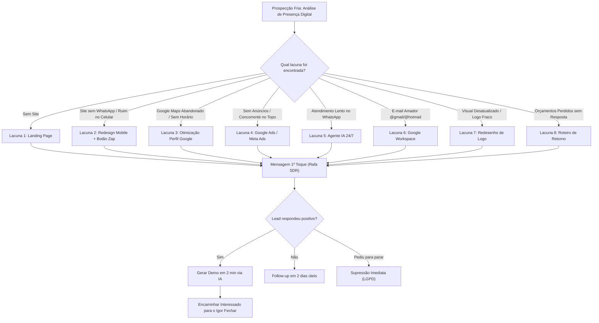

# Catálogo de Serviços Feitos com IA — OLLI Serviços
**Documento de Engenharia Comercial e Precificação · Versão 1.0**  
**Data:** 14/11/2026 · **Referência Operacional:** Ordem do Igor (14/11 ~05:20, áudio, D-2074 / D-2076)  
**Status Oficial:** `PROPOSTA COMERCIAL — SUJEITA À APROVAÇÃO DO MAQUIAVEL (OFENSIVA)`  
*(Aviso obrigatório: Nada aqui está publicado para clientes. Nenhum anúncio foi alterado. O app OLLI Orçamentos segue rigorosamente em Pro R$ 39 e Empresa R$ 99).*

---

## 0. Diretrizes Gerais e Freios Inegociáveis (D-2074 / D-2076)

1. **Transformação Estrutural:** A OLLI Serviços opera como agência ágil de soluções digitais executadas com IA para negócios locais, prestadores de serviços e PMEs em todo o território nacional.
2. **Motor de Prospecção Existente:** Toda a prospecção ativa fria opera via `/home/igor/chatwoot-central/campanhas/prospeccao/` (Rafa SDR), respeitando o ritmo seguro (teto diário, janelas comerciais, freio de denúncias e retorno automático em 2 dias úteis).
3. **Piso Legal LGPD e Origem dos Contatos (D-2076):**
   - Base de dados abertos cadastrais da Receita Federal liberada para pessoas jurídicas e físicas atuantes no mercado.
   - A mensagem de primeiro toque declara com transparência quem somos ("Aqui é o Rafa, da OLLI").
   - Qualquer contato que perguntar a origem do número recebe a resposta factual: *"Localizamos o contato público nos dados abertos cadastrais da Receita Federal / site público da empresa"*.
   - **Supressão Imediata e Irreversível:** Qualquer solicitação de parada ("não tenho interesse", "favor parar", "remover", "sair") gera bloqueio e inclusão imediata na lista de supressão sem insistência, sem questionamento e sem qualquer envio futuro.
4. **Conformidade CDC (Código de Defesa do Consumidor):**
   - Zero promessas de resultado milagroso ou garantia de faturamento ("dobre suas vendas", "garantia de 50 novos clientes"). A entrega é puramente técnica, estrutural e operacional.
5. **Aprovação de Preços:**
   - Todos os preços deste catálogo são **sugestões de piso ("a partir de")** baseadas em dados de mercado. Quem aprova o valor final e autoriza propostas comerciais é o **Maquiavel (ofensiva)**.
6. **Mecanismo de Demonstração em 2 Minutos:**
   - O SDR identifica a lacuna do lead; os interessados são encaminhados ao Igor; a demo é gerada sob medida via IA em minutos a partir do que o lead respondeu.

---

## 1. Catálogo dos 12 Serviços Feitos com IA

---

### Serviço 1: Landing Page / Site Institucional de Alta Conversão

* **O que é:** Criação de página web profissional de alta velocidade, focada em conversão direta para o WhatsApp, estruturada com copywriting persuasivo adaptado ao nicho do cliente, design responsivo para smartphones e otimização para mecanismos de busca locais.
* **Para quem:** Empresas e profissionais que não possuem site, possuem apenas redes sociais ou têm sites antigos que não abrem direito no celular e não geram contatos.
* **Prazo de entrega:** 24 a 48 horas úteis após envio das informações básicas.
* **O que o cliente precisa dar:** Nome da empresa, ramo de atuação, lista dos principais serviços prestados, fotos do trabalho (ou autorização para fotos ilustrativas com IA), endereço e telefone do WhatsApp de atendimento.
* **O que entregamos:**
  - Landing page completa publicada (HTML5/Tailwind ou CMS rápido);
  - Botão de WhatsApp fixo com mensagem pré-preenchida de chamada;
  - Seções: Cabeçalho com proposta de valor, Sobre nós, Serviços detalhados, Diferenciais, Depoimentos/Provas sociais, Galeria de serviços, Mapa/Localização e Rodapé com dados legais;
  - Configuração de tags de rastreamento (Pixel Meta e Google Tag);
  - Otimização para carregamento em menos de 2 segundos no mobile.
* **Como provamos (A Demo em 2 minutos):** O robô de IA gera uma prévia instantânea (screenshot navegável ou link efêmero de preview) da landing page já com a marca, as cores e a cidade do lead em menos de 2 minutos após a resposta positiva.
* **Riscos e Mitigações:**
  - *Risco:* Dependência de domínio próprio ou demora do cliente em registrar o domínio.
  - *Mitigação:* A OLLI disponibiliza publicação imediata em subdomínio seguro provisório ou auxilia na compra do domínio no Registro.br (R$ 40/ano pago direto pelo cliente).
  - *Risco CDC:* Expectativa de vendas imediatas. Cláusula expressa de que o site é canal de comunicação e presença, sem garantia de volume de acessos.
* **Preço Sugerido "A partir de":** `[PROPOSTA SUJEITA À APROVAÇÃO DO MAQUIAVEL]`
  - **Implantação (Setup único): R$ 690,00**
  - **Manutenção / Hospedagem opcional:** R$ 59,00/mês (ou cliente hospeda por conta própria).
* **3 Referências Reais de Mercado Brasileiro:**
  1. *Agência FourM* (agenciafourm.com.br, consultado 14/11/2026): Landing pages profissionais para pequenos negócios locais variam de **R$ 600 a R$ 1.500** (freelancer iniciante/básico) e **R$ 1.800 a R$ 3.500** (especialista).
  2. *Decolar Negócio* (decolarnegocio.com.br, consultado 14/11/2026): Criação de landing page focada em conversão para WhatsApp custa entre **R$ 800 e R$ 2.500**.
  3. *Krios Creative* (krioscreative.com, consultado 14/11/2026): Faixa média praticada para páginas comerciais com copy inclusa: **R$ 1.200 a R$ 3.000**.

---

### Serviço 2: Atendimento Automatizado no WhatsApp com IA (Central Chatwoot + Agente IA 24/7)

* **O que é:** Implantação de um assistente virtual inteligente com modelo de linguagem (LLM Llama 3.3 70B Fast) integrado ao WhatsApp do cliente através da central de atendimento Chatwoot. O agente responde dúvidas frequentes na hora, coleta dados do chamado (endereço, urgência, tipo de serviço) e passa a conversa organizada para a equipe humana.
* **Para quem:** Prestadores de serviços com alto volume de mensagens, negócios que perdem orçamentos à noite ou nos fins de semana e empresas que demoram mais de 30 minutos para responder um novo cliente.
* **Prazo de entrega:** 48 horas úteis.
* **O que o cliente precisa dar:** Lista de perguntas frequentes, tabela de preços básicos ou critérios de orçamento, horário de funcionamento e QR Code do WhatsApp para conexão.
* **O que entregamos:**
  - Instância e caixa de entrada na central Chatwoot;
  - Conexão do número de WhatsApp do cliente;
  - Roteiro de triagem e qualificação do lead personalizado;
  - Treinamento do robô com dados da empresa (regras de atendimento e tom de voz);
  - Repasse automático para os atendentes humanos com notificação;
  - Painel para o cliente acompanhar todas as conversas pelo computador e app móvel.
* **Como provamos (A Demo em 2 minutos):** Enviamos um link para um WhatsApp de teste da OLLI ou simulador web onde o lead conversa com um robô já configurado com o nome da empresa dele e testa fazer uma pergunta difícil de orçamento.
* **Riscos e Mitigações:**
  - *Risco:* WhatsApp não oficial via QR Code pode sofrer restrições da Meta se usado para spam.
  - *Mitigação:* O robô atua **exclusivamente no atendimento receptivo** (inbound). A OLLI formaliza em contrato que o cliente não deve usar a conexão para disparos em massa não autorizados.
  - *Risco CDC:* Alucinação de IA em preços. O robô é travado para dizer que orçamentos específicos e valores finais dependem de confirmação técnica da equipe humana.
* **Preço Sugerido "A partir de":** `[PROPOSTA SUJEITA À APROVAÇÃO DO MAQUIAVEL]`
  - **Implantação: R$ 490,00**
  - **Mensalidade: R$ 297,00/mês** (franquia de até 300 conversas atendidas pela IA).
* **3 Referências Reais de Mercado Brasileiro:**
  1. *Zap Trend* (zaptrend.com.br, consultado 14/11/2026): Agente IA para WhatsApp com fluxo personalizado varia de **R$ 500 a R$ 1.400/mês**.
  2. *Chat Inteligente* (chatinteligente.com.br, consultado 14/11/2026): Plataforma de chatbot com IA parte de **R$ 490/mês** no plano básico até **R$ 1.990/mês** no empresarial.
  3. *Flowup Agency* (flowup.agency, consultado 14/11/2026): Implantação de agente de IA para atendimento em pequenos negócios custa entre **R$ 1.000 (setup) + R$ 400 a R$ 900/mês**.

---

### Serviço 3: Conexão Multi-atendente no WhatsApp (Central Unificada de Atendimento)

* **O que é:** Configuração de uma central profissional (Chatwoot) permitindo que vários colaboradores atendam clientes simultaneamente utilizando um único número de WhatsApp comercial da empresa, com controle de filas, tags e histórico unificado.
* **Para quem:** Negócios com 2 ou mais pessoas atendendo que hoje passam o aparelho celular de mão em mão, perdem históricos ou não sabem qual atendente respondeu determinado cliente.
* **Prazo de entrega:** 24 horas úteis.
* **O que o cliente precisa dar:** E-mails dos atendentes para criação de usuários, nomes das equipes/setores (ex.: Comercial, Suporte, Financeiro) e conexão via QR Code.
* **O que entregamos:**
  - Central multi-atendente em nuvem configurada;
  - Até 5 usuários humanos com logins individuais;
  - Divisão de departamentos/filas;
  - Respostas rápidas pré-programadas gravadas no sistema;
  - Treinamento gravado de 30 minutos em vídeo para a equipe.
* **Como provamos (A Demo em 2 minutos):** Demonstração em vídeo ou tela compartilhada do painel com 2 atendentes conversando ao mesmo tempo pelo mesmo número demonstrativo.
* **Riscos e Mitigações:**
  - *Risco:* Queda de conexão do aparelho principal.
  - *Mitigação:* Alerta automático por e-mail/sistema caso a sessão do WhatsApp desconecte e suporte para reconexão em 1 clique.
* **Preço Sugerido "A partir de":** `[PROPOSTA SUJEITA À APROVAÇÃO DO MAQUIAVEL]`
  - **Implantação: R$ 350,00**
  - **Mensalidade: R$ 197,00/mês** (para até 5 atendentes).
* **3 Referências Reais de Mercado Brasileiro:**
  1. *ChatWoot BR Gerenciado* (chatwoot.app.br, consultado 14/11/2026): Mensalidade de **R$ 414/mês** para até 10 agentes em nuvem.
  2. *Digisac* (digisac.com.br, consultado 14/11/2026): Setup de implantação de central multi-atendimento a partir de **R$ 1.200 uma vez** mais mensalidade por licença.
  3. *AgeuBot* (ageubot.com.br, consultado 14/11/2026): Cobrança básica de **R$ 69,90/mês + R$ 29,90 por atendente adicional** (sem consultoria ou implantação feita por agência).

---

### Serviço 4: Otimização Completa de Perfil da Empresa no Google (Google Meu Negócio / SEO Local)

* **O que é:** Estruturação, verificação e otimização da ficha da empresa no Google Maps e na Pesquisa Google para posicionamento nas primeiras posições de busca local quando clientes buscam pelos serviços na cidade.
* **Para quem:** Prestadores de serviços e empresas físicas que não aparecem no mapa, estão com endereço/telefone desatualizados, horários errados ou poucas avaliações.
* **Prazo de entrega:** 48 horas úteis (sujeito ao prazo de validação do código postal ou verificação por vídeo do Google).
* **O que o cliente precisa dar:** Acesso administrativo à ficha do Google (ou autorização para criação), fotos do local/fachada/serviços, comprovante de endereço comercial, horários e lista de bairros atendidos.
* **O que entregamos:**
  - Ficha 100% preenchida e categorizada nas classes prioritárias do Google;
  - Redação estratégica de descrição com palavras-chave de maior volume de busca local;
  - Catálogo de produtos/serviços cadastrado dentro do perfil;
  - Tratamento e publicação de até 15 fotos otimizadas com geolocalização;
  - Link curto e QR Code personalizado para solicitar avaliações 5 estrelas via WhatsApp;
  - Modelos de respostas padronizadas para avaliações positivas e negativas.
* **Como provamos (A Demo em 2 minutos):** Auditoria visual instantânea da ficha atual do lead gerada pela IA, apontando uma nota de 0 a 10 e listando 5 erros críticos que estão fazendo ele perder chamados para concorrentes da mesma rua/bairro.
* **Riscos e Mitigações:**
  - *Risco:* O Google pode suspender fichas se houver suspeita de informações falsas ou endereço residencial.
  - *Mitigação:* Seguir à risca as diretrizes oficiais do Google Meu Negócio, cadastrando área de cobertura sem exibição de endereço se a empresa for prestadora de serviços externa.
* **Preço Sugerido "A partir de":** `[PROPOSTA SUJEITA À APROVAÇÃO DO MAQUIAVEL]`
  - **Setup Único de Otimização: R$ 390,00**
  - **Gestão Mensal Local (Postagens + Respostas + Relatório): R$ 250,00/mês** (opcional).
* **3 Referências Reais de Mercado Brasileiro:**
  1. *2S Digital* (2sdigital.com.br, consultado 14/11/2026): Otimização de ficha local única custa de **R$ 250 a R$ 1.500**; gestão mensal de **R$ 400 a R$ 1.200/mês**.
  2. *Decolar Negócio* (decolarnegocio.com.br, consultado 14/11/2026): Média de mercado para setup de Google Meu Negócio gira entre **R$ 500 e R$ 800**.
  3. *Focus Arts* (focusarts.com.br, consultado 14/11/2026): Consultoria de SEO local e ficha Google Maps tabelada em **R$ 450 a R$ 900**.

---

### Serviço 5: Gestão de Tráfego Pago no Google Ads (Pesquisa Local e Chamados Urgentes)

* **O que é:** Planejamento, criação e gestão de campanhas de anúncios na Rede de Pesquisa do Google, fazendo a empresa aparecer no topo da página quando pessoas procurarem por termos como "eletricista 24 horas", "conserto de ar condicionado urgente" ou "oficina mecânica perto de mim".
* **Para quem:** Negócios de serviços emergenciais e empresas que precisam de ligações ou mensagens de WhatsApp de clientes prontos para comprar hoje.
* **Prazo de entrega:** 72 horas úteis para criação e ativação das primeiras campanhas.
* **O que o cliente precisa dar:** Definição do orçamento mensal de mídia a ser pago ao Google, áreas geográficas de atendimento (bairros ou raio de km), WhatsApp de recebimento e cartão para cobrança da fatura do Google.
* **O que entregamos:**
  - Conta de anúncios do Google Ads estruturada;
  - Estudo e seleção de palavras-chave negativas para não queimar verba com curiosos ("grátis", "curso", "como fazer");
  - Criação de anúncios responsivos de pesquisa com extensões de chamada e WhatsApp;
  - Configuração de conversão (clique no WhatsApp / chamada telefônica);
  - Otimização semanal de lances com IA e relatório simplificado mensal.
* **Como provamos (A Demo em 2 minutos):** Apresentamos uma simulação rápida do volume de buscas na cidade do lead para a profissão dele (ex.: "Existem 1.400 buscas por mês de 'conserto de geladeira em Santo Amaro' e hoje 3 concorrentes seus estão pegando esses clientes").
* **Riscos e Mitigações:**
  - *Risco:* Verba consumida sem gerar retorno se os termos de busca forem mal negativados.
  - *Mitigação:* Foco obsessivo em correspondência exata e de frase, com negativas diárias na primeira semana.
  - *Risco CDC:* Nunca prometer custo por clique ou volume fixo de ligações. Deixar claro que a verba de anúncios é paga pelo cliente direto ao Google.
* **Preço Sugerido "A partir de":** `[PROPOSTA SUJEITA À APROVAÇÃO DO MAQUIAVEL]`
  - **Setup de Campanha: R$ 450,00**
  - **Fee Mensal de Gestão e Otimização: R$ 490,00/mês** (para verbas de até R$ 2.000/mês no Google).
* **3 Referências Reais de Mercado Brasileiro:**
  1. *Adriano Gianini Treinamentos* (adrianogianini.com.br, consultado 14/11/2026): Honorários médios de gestores para pequenos negócios locais variam de **R$ 500 a R$ 1.200/mês** (iniciante) a **R$ 1.500 a R$ 3.000/mês** (sênior).
  2. *Agência Ezen* (agenciaezen.com, consultado 14/11/2026): Gestão de campanhas Google Ads para serviços locais com honorários de **R$ 800 a R$ 2.000/mês**.
  3. *Mardini Comunicação* (mardini.com.br, consultado 14/11/2026): Taxa de implantação/setup de **R$ 500 a R$ 1.500** + fee fixo mensal.

---

### Serviço 6: Gestão de Tráfego no Meta Ads (Instagram/Facebook) + Meta Business Suite

* **O que é:** Criação e veiculação de anúncios patrocinados no Feed, Stories e Reels do Instagram e Facebook, direcionando pessoas da cidade/bairro para iniciar conversa no WhatsApp comercial, além da organização e verificação do Meta Business Suite.
* **Para quem:** Negócios locais com apelo visual ou serviços que as pessoas contratam por confiança e proximidade (reformas, estética, automotivo, instalações residenciais e comerciais).
* **Prazo de entrega:** 72 horas úteis.
* **O que o cliente precisa dar:** Acesso de parceiro à página do Facebook e perfil comercial do Instagram, fotos/vídeos dos serviços e definição da verba de anúncio (mínimo recomendado: R$ 20 a R$ 30/dia).
* **O que entregamos:**
  - Meta Business Suite verificado e configurado;
  - Criação de campanhas de tráfego e engajamento focadas em mensagens diretas no WhatsApp;
  - Segmentação geográfica rigorosa por CEP ou raio de quilometragem;
  - 4 anúncios criados (vídeo ou imagem + copy de alta conversão gerada por IA);
  - Acompanhamento semanal de custo por conversa iniciada e relatório quinzenal.
* **Como provamos (A Demo em 2 minutos):** Geramos um mock-up instantâneo do anúncio no feed do Instagram, com a foto do trabalho do cliente, texto chamativo e botão "Enviar mensagem no WhatsApp".
* **Riscos e Mitigações:**
  - *Risco:* Bloqueio de contas de anúncios pela Meta por políticas automatizadas.
  - *Mitigação:* Análise prévia das diretrizes publicitárias da Meta; uso de termos neutros sem promessas sensacionalistas ("antes e depois" agressivo é evitado).
* **Preço Sugerido "A partir de":** `[PROPOSTA SUJEITA À APROVAÇÃO DO MAQUIAVEL]`
  - **Setup de Contas e Criativos Iniciais: R$ 400,00**
  - **Fee Mensal de Gestão: R$ 450,00/mês** (para verbas de até R$ 1.500/mês).
* **3 Referências Reais de Mercado Brasileiro:**
  1. *Cliente Flow* (clienteflow.com.br, consultado 14/11/2026): Gestão de tráfego no Meta Ads para negócios locais varia de **R$ 1.000 a R$ 2.500/mês**.
  2. *Wee Digital* (weedigital.com.br, consultado 14/11/2026): Plano básico de tráfego Instagram para pequenas empresas parte de **R$ 800/mês**.
  3. *Drive Digital* (drivedigital.com.br, consultado 14/11/2026): Média de honorários de agência para gestão local gira entre **R$ 900 e R$ 2.200/mês**.

---

### Serviço 7: Identidade Visual e Redesenho de Logotipo Profissional

* **O que é:** Criação ou modernização do logotipo da empresa, com vetorização completa para alta definição, definição de paleta de cores corporativa, tipografia oficial e entrega do guia prático de aplicação em uniformes, cartões, adesivos de veículos e redes sociais.
* **Para quem:** Empresas que usam imagens borradas baixadas da internet, artes amadoras feitas no Word ou que mudaram de foco e querem passar imagem profissional e de autoridade.
* **Prazo de entrega:** 24 a 48 horas úteis.
* **O que o cliente precisa dar:** Nome exato da empresa, slogan (se houver), cores de preferência e exemplos de marcas que admira.
* **O que entregamos:**
  - 3 opções conceituais criadas com assistência de IA e refinadas em vetor;
  - Arquivos finais em vetor aberto (`.SVG`, `.PDF`) e imagens com fundo transparente em alta resolução (`.PNG`);
  - Variações: Principal, Horizontal, Ícone/Avatar para WhatsApp/Instagram e Versão monocromática (preto/branco);
  - Mini-manual de marca (códigos hexadecimais de cores e nomes das fontes utilizadas);
  - Aplicação simulada em cartão de visita, fachada e camiseta.
* **Como provamos (A Demo em 2 minutos):** A IA gera instantaneamente 2 variações modernas e polidas do logo atual do cliente e mostra como ele ficaria na foto de perfil do WhatsApp e em um uniforme.
* **Riscos e Mitigações:**
  - *Risco:* Dificuldade do cliente em aprovar layouts (pedidos infinitos de refação).
  - *Mitigação:* Limite claro contratual de até 2 rodadas de revisões pontuais dentro do conceito escolhido.
* **Preço Sugerido "A partir de":** `[PROPOSTA SUJEITA À APROVAÇÃO DO MAQUIAVEL]`
  - **Projeto de Redesenho de Logo e Paleta: R$ 390,00** (pagamento único).
* **3 Referências Reais de Mercado Brasileiro:**
  1. *Cleiton Avi Branding* (cleitonavi.com, consultado 14/11/2026): Identidade visual básica para autônomos e MEIs varia de **R$ 800 a R$ 2.500**; logos isolados em freelancers experientes de **R$ 400 a R$ 800**.
  2. *Buffo Estúdio* (buffo.com.br, consultado 14/11/2026): Projetos de redesign e modernização de marca local variam de **R$ 1.200 a R$ 4.000**.
  3. *Nocton Design* (nocton.com.br, consultado 14/11/2026): Pacotes de identidade visual com entregáveis em vetor e manual custam a partir de **R$ 1.500**.

---

### Serviço 8: Pacote de Criativos e Posts para Redes Sociais com IA

* **O que é:** Produção em lote de materiais gráficos profissionais para Instagram e WhatsApp (artes para feed, carrosséis educativos e stories promocionais) com legendas persuasivas e hashtags adequadas ao nicho do cliente.
* **Para quem:** Prestadores de serviços que passam semanas sem postar nada nas redes sociais por falta de tempo, criatividade ou habilidade com ferramentas de design.
* **Prazo de entrega:** 48 horas úteis.
* **O que o cliente precisa dar:** Fotos de trabalhos recentes (obras, peças, atendimentos), serviços que deseja promover no mês e promoções ou diferenciais da empresa.
* **O que entregamos:**
  - Pacote com 12 artes estáticas e carrosséis diagramados no padrão visual da empresa;
  - 12 legendas completas com chamadas para ação (CTA) para o WhatsApp;
  - Calendário sugerido de publicação (dias e horários de maior engajamento);
  - Arquivos organizados no Google Drive prontos para postar ou enviados via WhatsApp.
* **Como provamos (A Demo em 2 minutos):** Criamos 1 post real com foto do próprio serviço do cliente, texto impecável e o logo dele, enviado na conversa do WhatsApp para ele ver o nível de acabamento.
* **Riscos e Mitigações:**
  - *Risco:* Imagens geradas parecerem genéricas demais ("com cara de inteligência artificial").
  - *Mitigação:* Uso prioritário de fotos reais do próprio trabalho do prestador, aplicando filtros profissionais, molduras da marca e textos objetivos.
* **Preço Sugerido "A partir de":** `[PROPOSTA SUJEITA À APROVAÇÃO DO MAQUIAVEL]`
  - **Pacote 12 Posts/Criativos (Entrega Única): R$ 350,00**
  - **Assinatura Mensal (12 posts novos todo mês): R$ 290,00/mês**.
* **3 Referências Reais de Mercado Brasileiro:**
  1. *Agência Ezen* (agenciaezen.com, consultado 14/11/2026): Criação de pacotes mensais de 12 a 15 posts com copy varia de **R$ 600 a R$ 1.200/mês**.
  2. *Decolar Negócio* (decolarnegocio.com.br, consultado 14/11/2026): Kit avulso de 10 criativos profissionais para anúncios custa de **R$ 400 a R$ 800**.
  3. *Tabela Referencial Freelancer Brasil / ABEDI* (consultado 14/11/2026): Criação avulsa de posts estáticos custa de **R$ 40 a R$ 90 por peça** no mercado de design nacional.

---

### Serviço 9: Implantação de Google Workspace e E-mail Corporativo (@suaempresa.com.br)

* **O que é:** Configuração técnica e ativação de contas de e-mail corporativo no Google Workspace (Gmail institucional com domínio próprio, ex.: `contato@suaempresa.com.br`), com parametrização completa de segurança (DNS, SPF, DKIM, DMARC) para evitar que mensagens caiam na caixa de spam de clientes.
* **Para quem:** Empresas que ainda utilizam contas genéricas gratuitas (`empresa123@gmail.com` ou `@hotmail.com`) em propostas comerciais, orçamentos e contratos, transmitindo amadorismo.
* **Prazo de entrega:** 24 horas úteis.
* **O que o cliente precisa dar:** Acesso ao painel do domínio (Registro.br ou provedor de DNS), lista dos nomes e e-mails dos usuários a serem criados e cartão de crédito para a assinatura das contas no Google.
* **O que entregamos:**
  - Configuração de registros MX, TXT (SPF), DKIM e DMARC no painel de DNS;
  - Criação de até 3 contas de e-mail institucionais no painel de administração;
  - Configuração de assinaturas de e-mail padronizadas com o logotipo da empresa;
  - Migração de mensagens antigas do e-mail anterior (se houver, até 5 GB);
  - Manual ilustrado de acesso via navegador e aplicativo Gmail no celular.
* **Como provamos (A Demo em 2 minutos):** Mostramos o contraste visual imediato entre um orçamento enviado por `eletricaroberto@gmail.com` versus um por `atendimento@eletricaroberto.com.br`, ressaltando o aumento de confiança que fecha contratos maiores.
* **Riscos e Mitigações:**
  - *Risco:* O cliente confundir o serviço de configuração da agência com a mensalidade da licença cobrada pelo Google.
  - *Mitigação:* Contrato e proposta destacam claramente que o Google cobra cerca de R$ 33 a R$ 41/mês por usuário diretamente na fatura do cliente, sendo o valor da OLLI referente ao serviço técnico de setup e blindagem do domínio.
* **Preço Sugerido "A partir de":** `[PROPOSTA SUJEITA À APROVAÇÃO DO MAQUIAVEL]`
  - **Setup e Configuração Completa: R$ 290,00** (para até 3 contas; contas adicionais R$ 50 cada).
* **3 Referências Reais de Mercado Brasileiro:**
  1. *Grupo JJX Consultoria* (grupojjx.com.br, consultado 14/11/2026): Configuração e implantação profissional de Google Workspace para pequenas empresas varia de **R$ 300 a R$ 1.000**.
  2. *Locaweb Soluções* (locaweb.com.br, consultado 14/11/2026): Suporte e ativação de e-mail corporativo em nuvem custa entre **R$ 350 e R$ 800** para pequenos domínios.
  3. *Qualtir Tecnologia* (qualtir.com, consultado 14/11/2026): Taxa de configuração técnica de DNS, autenticação de segurança e migração de caixa postal parte de **R$ 350 a R$ 800**.

---

### Serviço 10: Mini-Sistema Web / Painel Sob Medida para Orçamentos e Ordens de Serviço

* **O que é:** Configuração e entrega de um painel web simplificado para o prestador gerar orçamentos em PDF com cara profissional, emitir ordens de serviço, cadastrar clientes e acompanhar recebimentos via Pix direto no celular ou computador (baseado na infraestrutura robusta do ecossistema OLLI).
* **Para quem:** Prestadores de serviços que ainda anotam orçamentos em caderno, mandam preços no corpo do WhatsApp em texto solto e sofrem com desorganização financeira e orçamentos esquecidos.
* **Prazo de entrega:** 24 a 48 horas úteis.
* **O que o cliente precisa dar:** Logotipo da empresa, dados cadastrais (CNPJ/CPF, endereço, telefone, chave Pix) e modelos de orçamentos mais comuns que costuma praticar.
* **O que entregamos:**
  - Painel de gestão web responsivo (funciona em qualquer celular ou PC sem instalação pesada);
  - Emissor de orçamentos e recibos em PDF em 1 toque com o logotipo e cores da empresa;
  - Link público seguro do orçamento para envio no WhatsApp do cliente final;
  - Cadastro de clientes e tabela de itens/serviços recorrentes;
  - Treinamento guiado de uso de 20 minutos.
* **Como provamos (A Demo em 2 minutos):** Geramos na hora um PDF de orçamento elegante e timbrado com os dados reais do prestador e um serviço típico dele, enviando o documento diretamente no WhatsApp dele.
* **Riscos e Mitigações:**
  - *Risco:* O cliente esperar funcionalidades complexas de ERP contábil ou emissão fiscal avançada.
  - *Mitigação:* Alinhamento de escopo no primeiro contato: é um sistema ágil focado em orçamentos, ordens de serviço e controle financeiro simples, sem complexidade desnecessária.
* **Preço Sugerido "A partir de":** `[PROPOSTA SUJEITA À APROVAÇÃO DO MAQUIAVEL]`
  - **Setup e Customização com a Marca: R$ 390,00**
  - **Assinatura do Sistema: R$ 99,00/mês** (Plano Empresa OLLI com múltiplos usuários e recursos completos).
* **3 Referências Reais de Mercado Brasileiro:**
  1. *Cronapp / Devs Low-Code Brasil* (cronapp.io / plataformas de software sob medida, consultado 14/11/2026): Mini-sistemas comerciais simples custam de **R$ 1.800 a R$ 5.000** para desenvolvimento inicial.
  2. *Marketplace Freelancers BR (99freelas / Workana)*: Criação de gerador de orçamentos e painel web sob medida é orçado entre **R$ 1.500 e R$ 4.000**.
  3. *Tabela OLLI Orçamentos* (olliorcamentos.online, homologado nov/2026): Plano Empresa homologado a **R$ 99/mês** (proposta de setup customizado adiciona R$ 390 de serviço de onboarding guiado e personalização).

---

### Serviço 11: Roteiro e Automação de Retorno de Orçamentos (Reativação de Clientes)

* **O que é:** Implantação de fluxo automatizado e cadência de acompanhamento (follow-up) no WhatsApp para cobrar de forma educada e estratégica o cliente que recebeu um orçamento e não respondeu, além de reativar contatos que fizeram serviços no ano anterior para oferecer revisões periódicas.
* **Para quem:** Prestadores que enviam dezenas de orçamentos por semana, mas não têm tempo de acompanhar a resposta e perdem até 40% dos serviços por falta de um segundo toque educado.
* **Prazo de entrega:** 24 horas úteis.
* **O que o cliente precisa dar:** Exemplos de objeções comuns de clientes (preço, prazo, dúvida técnica) e lista de contatos que receberam orçamentos recentes (em conformidade com a base do cliente).
* **O que entregamos:**
  - Roteiro validado de follow-up em 3 etapas (1º toque após 2 dias úteis, 2º toque após 5 dias úteis, mensagem de encerramento amigável);
  - Automação configurada na central de atendimento ou gatilhos manuais em 1 clique;
  - Script para reativação de clientes antigos (ex.: "Revisão preventiva de ar condicionado antes do verão");
  - Treinamento prático de como abordar o cliente sem parecer chato ou insistente.
* **Como provamos (A Demo em 2 minutos):** Enviamos no WhatsApp do lead o roteiro exato que ele poderá disparar hoje mesmo para 5 clientes que estão "no vácuo", para ele testar e ver a resposta dos clientes.
* **Riscos e Mitigações:**
  - *Risco:* Envio invasivo ou reclamação de spam.
  - *Mitigação:* Roteiro estritamente consultivo, amigável e com saída honrosa ("Se não for prioridade agora, sem problema!"). Se o cliente disser que já fechou com outro ou não quer, é suprimido na hora.
* **Preço Sugerido "A partir de":** `[PROPOSTA SUJEITA À APROVAÇÃO DO MAQUIAVEL]`
  - **Setup e Configuração dos Fluxos: R$ 290,00** (pagamento único).
* **3 Referências Reais de Mercado Brasileiro:**
  1. *NextLeads Consultoria SDR* (nextleads.com.br, consultado 14/11/2026): Estruturação de cadências de follow-up e recuperação comercial custa entre **R$ 1.200 e R$ 3.000**.
  2. *Conexão Lead* (conexaolead.com.br, consultado 14/11/2026): Módulo de recuperação de propostas perdidas cobrado a partir de **R$ 800 a R$ 1.800**.
  3. *Zap Trend Automações* (zaptrend.com.br, consultado 14/11/2026): Fluxo personalizado de pós-orçamento orçado em **R$ 450 a R$ 900**.

---

### Serviço 12: Automação de Agendamento Online Integrada ao WhatsApp e Google Agenda

* **O que é:** Sistema onde o cliente final escolhe o melhor dia e horário para a visita técnica ou serviço diretamente pelo WhatsApp ou por um link rápido, sincronizando automaticamente com a Google Agenda do prestador e enviando lembretes contra esquecimentos.
* **Para quem:** Profissionais que perdem tempo no WhatsApp no "jogo de adivinhação de horários" ("quarta você pode?", "não, quarta não posso, pode quinta?"), sofrem com faltas de clientes e esquecem compromissos.
* **Prazo de entrega:** 24 a 48 horas úteis.
* **O que o cliente precisa dar:** Horários disponíveis na semana, tempo médio de cada visita/atendimento, endereço ou raio de deslocamento e acesso à conta do Google Agenda.
* **O que entregamos:**
  - Página de agendamento online com a marca da empresa;
  - Sincronização bidirecional em tempo real com o Google Calendar do profissional (horário ocupado não aparece);
  - Confirmação automática via mensagem de WhatsApp assim que o cliente agenda;
  - Lembrete automático enviado 2 horas antes da visita agendada para evitar que o prestador dê viagem perdida.
* **Como provamos (A Demo em 2 minutos):** Enviamos um link de agendamento demonstrativo onde o lead escolhe um horário e vê na hora o evento brotar na agenda e o WhatsApp dele receber a confirmação.
* **Riscos e Mitigações:**
  - *Risco:* Conflito de agenda se o prestador marcar compromissos fora do sistema.
  - *Mitigação:* A sincronização é total: se o prestador colocar qualquer evento pessoal na agenda do celular, o sistema bloqueia automaticamente aquele horário no agendamento dos clientes.
* **Preço Sugerido "A partir de":** `[PROPOSTA SUJEITA À APROVAÇÃO DO MAQUIAVEL]`
  - **Setup e Integração: R$ 350,00**
  - **Manutenção/Integração opcional: R$ 49,00/mês**.
* **3 Referências Reais de Mercado Brasileiro:**
  1. *Agências de Automação n8n / Zapier BR* (agencian8n.com.br, consultado 14/11/2026): Implantação de agendador integrado com WhatsApp parte de **R$ 500 a R$ 1.200**.
  2. *Chat Inteligente Agendamento* (chatinteligente.com.br, consultado 14/11/2026): Módulo de marcação de visitas e consultas em chatbots orçado em **R$ 390 a R$ 890**.
  3. *AgeuBot Automações* (ageubot.com.br, consultado 14/11/2026): Setup de fluxo de agendamento automático na faixa de **R$ 350 a R$ 750**.

---

## 2. Pacotes Integrados Estratégicos (Soluções Completas)

Para aumentar o ticket médio e facilitar a tomada de decisão do lead, a OLLI estrutura **2 Pacotes Principais** e **1 Pacote de Aceleração Total**.

```
+----------------------------------------------------------------------------------------------------+
|                                    ESTRUTURA DOS PACOTES OLLI                                      |
+------------------------------------+-----------------------------------+---------------------------+
| PACOTE 1: PRESENÇA ONLINE TOTAL    | PACOTE 2: ATENDIMENTO AUTOMÁTICO  | PACOTE 3 (BÔNUS): ACELERA |
| (Para quem é invisível ou amador)  | (Para quem perde leads no Zap)    | (Máquina de Vendas 360°)  |
|                                    |                                   |                           |
| • Redesenho de Logo e Cores        | • Central Multi-atendente Chatwoot| • Tudo do Pacote 1        |
| • Landing Page de Alta Conversão   | • Agente IA 24/7 Qualificador     | • Tudo do Pacote 2        |
| • Otimização Google Meu Negócio    | • Roteiro de Retorno de Orçamento | • Campanha Google Ads     |
| • E-mail Corporativo Google        | • Automação de Agendamento        | • Campanha Meta Ads       |
|                                    |                                   |                           |
| Setup: R$ 1.190 à vista            | Setup: R$ 790 (uma vez)           | Setup: R$ 1.790           |
| Mensalidade: R$ 59/mês (opcional)  | Mensalidade: R$ 497/mês           | Mensalidade: R$ 890/mês   |
+------------------------------------+-----------------------------------+---------------------------+
```

---

### Pacote 1: "Presença Online Total"
*Ideal para o prestador de serviços ou empresa que quer parar de parecer amador e ter uma presença digital respeitável em menos de 1 semana.*

* **Serviços inclusos no pacote:**
  1. Redesenho de Logotipo e Padronização Visual (Serviço 7 — valor avulso R$ 390);
  2. Landing Page de Alta Conversão com Botão WhatsApp (Serviço 1 — valor avulso R$ 690);
  3. Otimização Completa do Perfil no Google / Maps (Serviço 4 — valor avulso R$ 390);
  4. Configuração de E-mail Corporativo Google Workspace (Serviço 9 — valor avulso R$ 290).
* **Prazo de entrega unificado:** 3 a 5 dias úteis.
* **Economia para o cliente:** A soma avulsa daria R$ 1.760. No pacote, o cliente economiza R$ 570.
* **Preço Sugerido "A partir de":** `[PROPOSTA SUJEITA À APROVAÇÃO DO MAQUIAVEL]`
  - **Setup Único Promocional: R$ 1.190,00 à vista** (ou 12x no cartão com juros da operadora).
  - **Manutenção / Hospedagem da Página:** R$ 59,00/mês (opcional).

---

### Pacote 2: "Máquina de Atendimento e Vendas no WhatsApp" ★ RECOMENDADO
*Ideal para empresas que já têm movimentação de clientes, mas perdem negócios porque não respondem na hora, deixam mensagens acumular ou esquecem de cobrar propostas enviadas.*

* **Serviços inclusos no pacote:**
  1. Conexão Multi-atendente na Central Chatwoot (Serviço 3 — valor avulso R$ 350);
  2. Agente Inteligente com IA 24/7 de Triagem e Qualificação (Serviço 2 — valor avulso R$ 490);
  3. Automação de Retorno de Orçamentos e Reativação (Serviço 11 — valor avulso R$ 290);
  4. Agendamento Online Integrado à Agenda do Profissional (Serviço 12 — valor avulso R$ 350).
* **Prazo de entrega unificado:** 48 a 72 horas úteis.
* **Economia para o cliente:** A soma avulsa dos setups daria R$ 1.480. No pacote, o setup sai pela metade.
* **Preço Sugerido "A partir de":** `[PROPOSTA SUJEITA À APROVAÇÃO DO MAQUIAVEL]`
  - **Implantação (Setup único): R$ 790,00** (50% no aceite e 50% na entrega homologada).
  - **Mensalidade Recorrente: R$ 497,00/mês** (inclui servidor compartilhado, até 800 conversas atendidas pela IA/mês, até 5 atendentes humanos e suporte contínuo via WhatsApp).

---

### Pacote Bônus: "Aceleração 360° (Presença + Tráfego + Atendimento IA)"
*Para o cliente que quer o ecossistema digital completo pronto para gerar ligações e vendas de forma imediata.*

* **O que inclui:** Todos os itens do Pacote 1 (Presença) + Todos os itens do Pacote 2 (Atendimento) + Configuração de Campanhas no Google Ads ou Meta Ads (Serviço 5 ou 6).
* **Preço Sugerido "A partir de":** `[PROPOSTA SUJEITA À APROVAÇÃO DO MAQUIAVEL]`
  - **Setup Único Completo: R$ 1.790,00**
  - **Mensalidade Recorrente: R$ 890,00/mês** (Atendimento IA + Gestão Semanal de Tráfego + Hospedagem).

---

## 3. Roteiro Operacional de Oferta por Lacuna Encontrada no Lead

O motor de prospecção fria (`/home/igor/chatwoot-central/campanhas/prospeccao/` — Rafa SDR) opera abordando o lead pela **dor específica** identificada na presença digital dele.



---

### Matriz de Abordagem por Lacuna

| # | Lacuna Detectada | Como Detectar em 60s | Mensagem de 1º Toque (Rafa SDR) | Demonstração em 2 Minutos | Serviço / Pacote Indicado |
|---|---|---|---|---|---|
| **1** | **Sem Site** (só tem Instagram ou ficha básica) | Busca no Google: só aparece redes sociais ou diretórios (GuiaMais, TeleListas). | *"Oi, equipe da [Nome]. Aqui é o Rafa, da OLLI. Vi que vocês atendem serviços em [Cidade], mas quando o cliente procura no Google não acha o site de vocês. Posso te mostrar em 2 minutos como uma página rápida no WhatsApp coloca sua empresa na frente aqui na região?"* | Screenshot de uma página pronta com as cores e nome da empresa do lead. | **Serviço 1** (Landing Page) ou **Pacote 1** (Presença) |
| **2** | **Site sem WhatsApp / Ruim no Celular** | Abre o site no celular: não tem botão flutuante de WhatsApp, texto minúsculo ou link quebrado. | *"Oi, equipe da [Nome]. Rafa, da OLLI. Estava olhando o site de vocês pelo celular e vi que o cliente não consegue chamar no WhatsApp com 1 toque para pedir orçamento. Posso te mostrar em 2 minutos como fica o botão direto que dobra os contatos?"* | Link com visualização mobile do site corrigido com botão verde de 1 toque. | **Serviço 1** (Ajuste/Landing) |
| **3** | **Google Maps Incompleto / Sem Horário** | Ficha do Google não tem horário de funcionamento, fotos reais ou está com dados antigos. | *"Oi, equipe da [Nome]. Aqui é o Rafa, da OLLI. Notei que a ficha de vocês no Google Maps está sem horário de atendimento e sem os serviços principais cadastrados. Posso te mandar em 2 minutos um raio-x do que ajustar para subir no mapa da cidade?"* | Relatório visual rápido de 3 pontos que estão rebaixando a ficha no Google. | **Serviço 4** (Perfil da Empresa no Google) |
| **4** | **Sem Anúncios** (Concorrentes compram o termo na cidade) | Busca por "[Serviço] em [Cidade]": aparecem 3 concorrentes patrocinados e o lead não aparece. | *"Oi, equipe da [Nome]. Rafa, da OLLI. Vi que hoje quando pesquisam por [Serviço] em [Cidade], 3 concorrentes seus aparecem no topo do Google. Posso te mostrar em 2 minutos como colocar sua empresa ali quando alguém precisar de serviço urgente?"* | Prévia do anúncio do lead pronto no topo da busca simulada do Google. | **Serviço 5** (Google Ads) ou **Serviço 6** (Meta Ads) |
| **5** | **Atendimento Lento no WhatsApp** | O SDR manda um "Olá" fora de hora ou sábado e demora mais de 1 hora para receber resposta. | *"Oi, equipe da [Nome]. Aqui é o Rafa, da OLLI. Sei que na correria do dia a dia é difícil responder todo mundo no WhatsApp na hora, principalmente à noite e fim de semana. Posso te mostrar em 2 minutos um atendente de IA que responde na hora, faz a triagem e passa o orçamento mastigado para vocês?"* | Link do WhatsApp de teste onde o lead conversa com o robô simulador. | **Serviço 2** (Agente IA) ou **Pacote 2** (Atendimento) |
| **6** | **E-mail Amador (@gmail/@hotmail)** | O e-mail de contato da empresa na internet é `fulano123@gmail.com`. | *"Oi, equipe da [Nome]. Rafa, da OLLI. Vi o contato de vocês e reparei que ainda usam @gmail para fechar orçamentos. Posso te mostrar em 2 minutos como ter o e-mail oficial @[nomedaempresa].com.br no próprio Gmail do celular para passar mais segurança em contratos maiores?"* | Imagem comparativa de uma proposta vinda de `@gmail` vs `@empresa.com.br`. | **Serviço 9** (Google Workspace) |
| **7** | **Identidade Visual Amadora / Sem Logo** | Foto de perfil borrada, sem logotipo ou texto ilegível. | *"Oi, equipe da [Nome]. Aqui é o Rafa, da OLLI. Estava olhando o perfil de vocês e achei o serviço muito bom, mas o visual do logo não valoriza a qualidade do que vocês entregam. Posso te mandar em 2 minutos 2 opções modernizadas do logo de vocês sem compromisso?"* | 2 opções de logo polidas em alta definição geradas com IA em mock-up. | **Serviço 7** (Identidade Visual) |
| **8** | **Orçamentos Sem Retorno** (Para quem já é prestador ativo) | Perfil com muitos orçamentos enviados mas sem processo de pós-venda. | *"Oi, equipe da [Nome]. Rafa, da OLLI. Uma dúvida rápida: quantos clientes que receberam orçamento de vocês no mês passado sumiram sem responder? Posso te mandar em 2 minutos a mensagem exata que usamos para recuperar esses clientes sem parecer insistente?"* | Roteiro pronto de follow-up em 3 frases para ele copiar e colar. | **Serviço 11** (Retorno de Orçamentos) |

---

### Mensagem de Retorno Único (Após 2 Dias Úteis)

Se o lead não responder ao primeiro toque, o sistema do Rafa SDR aguarda **exatamente 2 dias úteis** e envia um único retorno discreto e sem pressão:

> *"Oi, equipe da [Nome]. Rafa, da OLLI, de novo. Se olhar isso para a empresa não for uma prioridade agora, sem problema nenhum. Se for, só me responde com um sim que te mostro em 2 minutos."*

- Se o lead não responder após o segundo toque: o contato é arquivado automaticamente (sem novo envio).
- Se o lead disser "não tenho interesse" ou "favor não mandar mais mensagem": inclusão imediata na lista de **supressão irreversível**.

---

## 4. Política de Custos Internos, Margens e Governança

### Custo Marginal Operacional por Cliente Atendido com IA

A infraestrutura técnica existente da OLLI garante margens de contribuição muito superiores às de agências tradicionais:

| Componente Técnico | Fornecedor / Tecnologia | Custo Real Unitário | Margem Bruta na Opção B (R$ 497/mês) |
|---|---|---|---|
| **Inteligência Artificial** | Cloudflare Workers AI (`llama-3.3-70b-instruct-fp8-fast`) | ~R$ 0,04 por conversa (~R$ 33/mês para 800 conversas) | **> 90%** |
| **Servidor / Central** | VPS KVM Hostinger (8 GB) particionada | R$ 20,00 por cliente/mês (compartilhado) | **> 85%** |
| **Conexão WhatsApp** | Conexão QR Code direta no servidor | R$ 0,00 por mensagem | **100%** |
| **Reserva Operacional** | Backup em nuvem e contingência | R$ 10,00 por cliente/mês | — |
| **Total Custo Caixa** | Infraestrutura direta | **R$ 63,00 / cliente / mês** | **Margem Bruta: R$ 434,00 (87%)** |

> **Conclusão de Caixa:** Com apenas **1 cliente ativo no Pacote 2 (R$ 497/mês)**, a OLLI já cobre a infraestrutura fixa inteira da operação comercial (R$ 137,39/mês), gerando caixa livre desde a primeira ativação.

---

## 5. Próximos Passos e Responsabilidades

1. **Aprovação Formal dos Preços:** Submissão deste catálogo e das 3 opções de pacotes ao **Maquiavel / Salomão (ofensiva)**.
2. **Integração com o Diagnóstico Automático (GZ-AGENCIA-2):** O script de detecção de lacunas consumirá esta matriz para classificar automaticamente os leads da Receita/Maps.
3. **Ativação da Prospecção Fria:** Rafa SDR utiliza exclusivamente os textos homologados deste catálogo, alimentando o Igor com leads qualificados para demonstração e fechamento.

---

**Fim do Catálogo · OLLI Serviços 2026**
